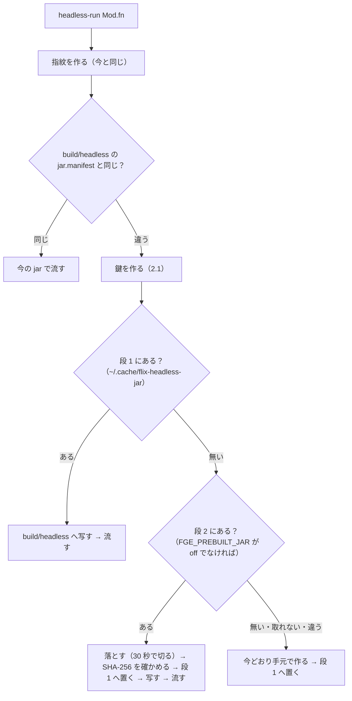

# 窓なしのゲームの jar を先に作っておく（prebuilt-jar）

状態（2026-10-20）: 段 1 を実装（`ababup1192/jarshare`）・段 2 を実装中。7 節の決め事は依頼主から「お任せ」をもらい、見回り役が決めた（7 節）。

ゲームの master に push されるたびに、Mac mini が `build/headless/headless.jar` を作って置いておく。Studio と `bin/headless-run` は、
指紋の合う jar があればそれを取ってきて使い、65 秒の組み立てを省く。合う物が無い・取れない時は、今どおり手元で作る。

前提: jar の指紋（`jar.manifest`）は jarfix（0.52.1 の見込み）の決まりに従う。

- 指紋は src・flix.toml・lib の中身から作る。lib は、flix.toml か packages.lock に名前のある版だけを入れる。
- jar を作る写しにだけある入口の束（写しの src/FgeHeadlessMain.flix）は入れない。
- 作り終えた後に、作った写し（`build/headless/proj`）から取り直す。
- java と java の旗は混ぜない（0.52）。

## 0. 今かかっている時間（実測・2026-10-20・internet_dungeon・Mac mini）

| 物 | 値 |
|---|---|
| jar を作る時間 | 65 秒（`build/headless/last-build-seconds`）。版を上げた直後の 1 回目は、lib へ依存を落とす分で長くなる |
| jar の大きさ | 41.3 MB（lwjgl の native は macOS・Linux・Windows の arm64 / x64 が全部入っている） |
| jar の中身の形 | Java 21 の class（class の版 65）。Studio の jre（21.0.12）でも端末の java（21.0.8）でも動く |
| ゲームの master への push | 1 日 49 回・7 日 391 回（first-parent）。直近の 60 回のうち、src・flix.toml・packages.lock が変わったのは 39 回 |
| この Mac mini の作業場 | `id-x-*` が数十あり、同じ指紋の jar を作業場ごとに作り直している |

最後の行が大事です。いちばん効くのは「Mac mini の外へ配る」より先に、**同じ機械の作業場どうしで同じ指紋の jar を分け合う**所です
（1 節の段 1）。

## 1. 置き場

2 段に分ける。どちらも鍵（2.1 節）で引き、中身の SHA-256 を添える。

| 段 | 置き場 | 誰が引くか |
|---|---|---|
| 段 1: 機械の中 | `~/.cache/flix-headless-jar/<鍵>/`（`headless.jar`・`jar.manifest`・`FgeHeadlessMain.flix`・`sha256`） | 同じ機械の作業場すべて（Mac mini のエージェント・Studio） |
| 段 2: 機械の外 | 下の表のどれか 1 つ | ほかの Mac の Studio・新しく clone した作業場 |

段 1 は、`headless-run` が jar を作り終えた時に必ず写す（作った人が置く）。Mac mini の常駐の作り手（3 節）は段 1 に置いてから、段 2 へ上げる。

段 2 の比べ:

| | GitHub Release の資産 | Actions の artifact | Mac mini の HTTP（Tailscale の中） |
|---|---|---|---|
| 1 本の大きさ | 2 GiB まで。41 MB は問題ない | 問題ない | 問題ない |
| 保つ期間 | 消すまで（古い順に消す仕組みが要る） | 1〜90 日（期限で自動で消える） | 消すまで（ディスクの上限で古い順に消す） |
| 費用 | 資産は容量の計算に入らない。ゲームの repo（private）でも無料 | private の repo では Actions の容量の枠を使う。41 MB × 1 日 39 回で、すぐ枠に当たる | 電気代だけ。Mac mini のディスク（空き 500 GB 超） |
| 認証 | gh のトークン（ゲームの repo を読める人だけ）。Studio の利用者が gh に入っている前提 | gh のトークン。API で zip 包みを解く手間がある | Tailscale の ACL。tailnet の外からは見えない |
| 落とす速さ | インターネット越しで 41 MB（数秒〜十数秒） | 同じ | 家の中なら 1 秒前後・外からは回線次第 |
| Mac mini が止まっている時 | 前に上げた物は取れる | 同じ | 取れない（手元で作るに戻る） |
| 置き方 | 1 つの「中の版」（例 `headless-jar-cache`・prerelease）に資産を `<鍵>.jar` で足していく。資産は 1 つの Release に 1000 本まで | ワークフローごとに上げる | 小さな HTTP の口（`bin/fge jar serve`） |

**勧め**: 段 1 は必ず入れる。段 2 は GitHub Release の資産にする。

- 費用がかからず、Mac mini が止まっていても取れるので。
- 認証は gh の今の仕組みに乗れるので（engine の道具はもう gh を使っている）。
- 古い物は「最後に使われてから 14 日・全部で 2 GB」を超えた順に消す（作り手が上げるたびに掃除する）。
- Tailscale の HTTP は、家の外の Studio に届かない日があるので、勧めない。

## 2. 流れ

### 2.1 鍵

鍵は次の字の SHA-256（16 進 64 字）にする。

```
fge-headless-jar/1
source=<元の指紋: src・flix.toml・packages.lock の中身の 64 字>   lib の中身は見ない（下）
dispatcher=<FgeHeadlessMain.flix の中身の SHA-256>               入口の束（src から拾った入口の一覧で決まる）
flix=<jar を作った flix.jar の SHA-256>                          コンパイラ（engine の bin/flix が指す物。lib には入っていない）
headless-run=<bin/headless-run の headless_revision>             作り方の決まり（入口の拾い方・dispatcher の書き方）を変えたら 1 上げる
```

- **実装で替えた所（2026-10-20）**: はじめは `jar.manifest`（jarfix の指紋・lib の中身まで見る）を混ぜる形だった。
  測ると、新しい作業場で鍵がそろわなかった。新しい作業場には lib が無く、flix が jar を作る途中で落とすので、作る前と作った後で指紋が変わるため。
  そこで lib の中身の代わりに packages.lock を混ぜる（`resident.BuildSourceManifest`）。
  lib/github は lock が toml と fpkg の SHA-256 で決め、lib/external（Maven の jar）は lock された toml の版で決まる。packages.lock の無いゲームは分け合わない。
- 取った作業場の `build/headless/jar.manifest` には、その作業場の今の指紋を書く。作り手の指紋を写すと、lib の無い作業場では次の回も古いと見えて、取り直し続けるため。
- `classfile` は鍵に入れなかった。コンパイラの jar（`flix=`）が同じなら class の版も同じで、手元で作っても同じ java で動かす。
- 指紋に入らないのに jar の中身を変える物を、残りの行で足している（3 節）。
- OS・CPU は鍵に入れない。jar は JVM の bytecode で、native は 3 つの OS と 2 つの CPU の分が全部入っている（0 節）。
  ただし、jar を使う側の java が `classfile` より古ければ使わない（2.3 節）。

### 2.2 headless-run（使う側）



- 写す物は 3 つ（`headless.jar`・`jar.manifest`・`proj/src/FgeHeadlessMain.flix`）。今の `is_stale` は、3 つがそろって指紋が同じなら作り直さない。
- 取ってきた時は、`[headless-run] 先に作った jar を使う（段 1 / 段 2・N 秒）` を 1 行出す。
- 取れない時の戻り方: 段 2 が無い・30 秒で落ちない・SHA-256 が違う・gh に入っていない時は、何も言わずに今どおり作る
  （`FGE_DEBUG=1` の時だけ訳を出す）。作れない時の止まり方（0.50 の「jar を作れない時は止める」）は今のまま。
- `FGE_PREBUILT_JAR=off` で段 2 を使わない。段 1 は止めない（同じ機械で作った物なので）。

### 2.3 落とした jar を使う前の確かめ

1. 落とした jar の SHA-256 が、置き場の `sha256` と同じ。
2. 使う側の java の版が `classfile`（65 = 21）以上。`java -version` を毎回は呼ばず、`headless-run` がもう決めている `java_cmd` の版を 1 回だけ見る。
3. jar の中の `FgeHeadlessMain` が、手元の src から拾った入口の一覧と同じ入口を持つ。これは鍵の `dispatcher` で決まっているが、
   写した `FgeHeadlessMain.flix` と手元の `build_dispatcher` の出力を字で比べて、もう一度確かめる。
4. どれかが違えば、段 1 からも消して、手元で作る。

### 2.4 Studio

Studio は今も `bin/headless-run E2e.serveHeadless` で窓なしのゲームを起こしていて、jar は `headless-run` が決める。
そのため、Studio に要る直しは 2 つだけ。

- `[headless-run] 先に作った jar を使う` の行を、起動の段の表示（`server/src/Headless.flix` の `BootStage`）に足す。今は「jar を作っています（65 秒）」と出る所が、「先に作った jar を使っています」になる。
- Studio がエンジンを入れ替えた直後（版を上げた直後）に、`bin/fge jar fetch` を裏で 1 回流しておく（2.5 節）。最初の 1 枚撮りまでに落としておく。

### 2.5 道具の口（実装した形）

| 口 | 中身 |
|---|---|
| `bin/fge jar key` | 鍵を出す（2.1） |
| `bin/fge jar fetch` | 段 1 → 段 2 の順に鍵の jar を探し、確かめて `build/headless` へ写す。取れた段（1 か 2）を出す。無ければ 1 を返す（作らない） |
| `bin/fge jar publish [--remote]` | `build/headless` の jar を段 1 へ置く。`--remote` で段 2 へも上げ、段 2 の古い物を消す（作り手だけが使う） |
| `bin/fge jar prune` | 段 1 の古い物を消す（最後に使ってから 14 日・全部で 2 GB を超えた順） |
| `bin/fge jar builder run --repo=<ゲームの clone>` | 作り手の 1 巡（4 節）。launchd が 5 分ごとに起こす |
| `bin/fge jar builder install｜uninstall --repo=<ゲームの clone> [--dry-run]` | 作り手を launchd に入れる・外す（`~/Library/LaunchAgents/com.flixge.jar-builder.<repo の名前>.plist`）。plist の型は `go/internal/jarshare/jar-builder.plist` |
| `bin/headless-run --build-only` | 入口を流さずに jar だけ作る（作り手が `FGE_JAR_PUBLISH_REMOTE=1` で使う） |

- `key`・`fetch`・`publish` は `--dispatcher=F --flix-jar=J --revision=N` を受ける。`bin/headless-run` が渡すので、手で打つ物ではない。
- 取り付けの手順（見回り役が依頼主に確かめてから）: 配ったエンジンの置き場から `~/.flix_ge_studio/engines/<版>/bin/fge jar builder install --repo=<internet_dungeon の clone>` を流す。plist は `install` を流したエンジンの `bin/fge` を指すので、エージェントの作業場からは流さない。
- PATH は、`install` の時に git・gh・java がいる実体（nix store）と OS の決まったフォルダだけを書く。

## 3. 指紋が同じでも中身が合わない危険と、その止め方

| 危険 | 止め方 |
|---|---|
| コンパイラ（flix）の版が違う。jar の bytecode が変わる。lib にもゲームの src にも出ない | 鍵の `flix=`（engine の `bin/flix` が使う flix.jar の SHA-256） |
| `headless-run` の入口の拾い方・dispatcher の書き方が違う | 鍵の `dispatcher=` と `headless-run=`。2.3 の 3 でもう一度比べる |
| 使う側の java が古い（class の版 65 を読めない） | 鍵の `classfile=` を、使う側で比べる（2.3 の 2）。合わなければ、java を替えるか手元で作るかを知らせて止める（今の手元の作り方でも同じ java で動かないので） |
| OS が違う | jar は bytecode だけで、native は全部の OS の分が入っている。鍵に入れない。<br>新しい依存が 1 つの OS の native だけを入れるようになった時に備えて、作り手は jar の中の native の OS の並びを `jar.manifest` の隣に書き、使う側で自分の OS があるかを見る |
| 途中まで落ちた・壊れた jar | `.tmp` に落としてから SHA-256 を確かめ、合った時だけ mv する |
| 他人が置いた jar（中身は手元で走るコード） | 段 2 は、ゲームの repo を読める gh のトークンでしか取れない（Release の資産）。<br>作り手だけが上げる（上げるトークンは Mac mini の作り手だけが持つ）。署名は付けない（勧め。7 節で決めてもらう） |
| 指紋の決まりが変わる（jarfix の後にまた直す） | 鍵の頭の `fge-headless-jar/1` を上げる。古い鍵の jar は、誰からも引かれなくなって消える |

## 4. 作り手（Mac mini）

- **引き金**（7 節の 2 で決めた）: Mac mini の launchd が 5 分ごとに `bin/fge jar builder run` を起こす。
  - `run` は、ゲームの master を fetch して、前に作った時から進んでいなければ何もせずに終わる。
  - ゲームの repo の設定（runner）は触らない。push のたびではなく 5 分ごとなので、続けて push が来ても最後の物だけ作る。
  - 同じ鍵がもう段 1・段 2 にあれば、作らずに終わる。直近 60 回の push のうち 21 回は src・flix.toml・packages.lock が変わらないので、そこで止まる。
  - launchd の plist の型は engine の中に置き、`bin/fge jar builder install|uninstall` で入れる・外す。Mac mini への取り付けは、見回り役が依頼主に確かめてから行う。
- **作るのに使うエンジン**: ゲームの flix.toml の版の、配った置き場（`~/.flix_ge_studio/engines/<版>`）。
  鍵にコンパイラと作り方の版が入るので、作り手と使う側が同じ版のエンジンを使えば鍵がそろう。
  その版に段 2 の口（`fge jar`）が無ければ、何もせずに終わる。
- **エンジンの置き場を作り手が用意する**（2026-10-20・依頼主の決定）: `--engine-repo=<エンジンの repo の作り手専用の clone>` を渡すと、
  ゲームの版の置き場（`<engines>/<版>`）が無い時に作り手が用意する（`go/internal/jarshare/provision.go`）。
  - エンジンの repo の clone が無ければ作り、タグを fetch する。タグ `v<版>` がまだ無ければ、記録に 1 行書いて待つ。
  - タグの作業場を一時の名前で作ってから `git worktree move` で置き場へ移し、`fge-go` を手元の OS の分だけ組む。
  - コンパイラの jar（`bin/flix.jar`）は、ほかの版の置き場に同じ flix の版（`devbox.json`）の物があれば写し、無ければ flix の Release から gh で落とす。
    どちらも `java -jar flix.jar --version` が `devbox.json` の版と同じかを確かめてから置く（リリースの `check-bundle-flix` と同じ確かめ方）。
  - Studio の置き場（`~/.flix_ge_studio/engines`）では用意しない（`--engine-repo` を渡した時だけ）。
  - 2026-10-20 の確かめ: 空の置き場から 0.53.0 を用意し、jar を段 1 から取って作り手の 1 巡が終わるまで 18 秒。
    落としたコンパイラの jar は、Studio の同梱・nix の物と同じ SHA-256。
- **重い物の鍵**: 作るのは `bin/fge heavy --short`（65 秒）で包む。この機械のエージェントの測りや reference-check と取り合わないように。
- **作り場**: 作り手専用の作業場（`~/.flix_ge_studio/prebuilt/<repo>`）を 1 つ持ち、`git fetch && git checkout --detach <sha>` して作る。エージェントの作業場には触らない。
- **1 日の費用**: 鍵が変わる push が 1 日 30〜40 回、1 回 65 秒（重なりを取り消せば実際はもっと少ない）で、Mac mini の CPU を 1 日 30〜45 分使う。

## 5. 効く場面と効かない場面（見込み）

| 場面 | 今 | 後 | 理由 |
|---|---|---|---|
| master を pull した直後の 1 枚撮り・render（Studio・端末） | 65 秒作ってから | 段 2 から 1〜15 秒 | 鍵が master の push と同じ |
| Studio がエンジンを入れ替えた直後（版を上げた直後） | 65 秒＋lib へ依存を落とす分 | 段 2 から（作り手が adopt の push で作っていれば） | 版を上げる push も master に来るので |
| この Mac mini で、新しく作業場を作った直後（`git worktree add`） | 65 秒 | 段 1 から 1 秒未満 | 同じ機械の誰かが同じ鍵を作っていれば |
| 同じ機械の別の作業場で、同じ src のまま render | 65 秒 | 段 1 から | 今は作業場ごとに作り直している |
| src を直した後 | 65 秒 | 65 秒（変わらない） | 指紋が変わるので、どこにも無い。手元で作るしかない |
| use-engine で作業中のエンジンへ向けた後 | 65 秒 | 65 秒 | lib の fpkg が手元の物で、誰も作っていない |
| 雛形（templates/*）・engine の中の bench | 65 秒 | 段 1 なら効く・段 2 は入れない | 作り手はゲームの master だけを見る |

エージェントの作業は src を直す事が多いので、段 2 が効くのは主に Studio（人）の側。この Mac mini のエージェントには段 1 が効く。
この機械では同じ作業場を何度も作り直しているので、新しい作業場を作るたびの 65 秒が消える。

## 6. 入れる順と完了条件

| 段 | 中身 | 完了条件（数は同じ機械で 5 回の中央値） |
|---|---|---|
| A | jarfix（別の担当）が入った後に、鍵（`bin/fge jar key`）と段 1（`headless-run` が作った後に置く・作る前に引く） | 新しい作業場を作った直後の `make render SHOT=title` が、jar の組み立てなし（ログに「先に作った jar を使う（段 1）」）。前は約 70 秒、後は 5 秒以下。鍵を変える変更（flix.jar・dispatcher）で段 1 を使わないことを、テストで確かめる |
| B | 段 2（Release の資産）と `fetch` / `publish` / `prune`・作り手の self-hosted runner | master に push してから、作り手が上げ終わるまでが 3 分以内。別の Mac の Studio で、pull した直後の会話の 1 枚撮りが jar の組み立てなし。gh に入っていない時と、30 秒で落ちない時に、手元で作るに戻る |
| C | Studio の起動の段の表示・エンジンを入れ替えた直後の `fetch` | Studio でエンジンを入れ替えた直後の最初の 1 枚撮りが、組み立てなし（作り手が作り終えていれば） |

各段で `agents-pack/AGENTS.core.md` の早見表に 1 行、`agents-pack/agent-eval/engine.json` にお題を 1 本足す（AGENTS.md の決まり）。

## 7. 決め事（2026-10-20・依頼主から「お任せ」をもらい、見回り役が決めた）

1. **段 2 の置き場は GitHub Release の資産。**
   - ゲームの repo の prerelease `headless-jar-cache` に、`<鍵>.jar` と `<鍵>.json`（中身の SHA-256・元の指紋・入口の束・作ったコミット）を置く。
2. **作り手の引き金は Mac mini の launchd。** 5 分ごとに git fetch して見に行く。ゲームの repo の設定を触らずに済むため、runner はやめた。
3. **段 1 を先に入れる。**
4. **署名は付けない。** gh のトークンで守り、上げられるのは作り手だけにする。
5. **残す量は 14 日・2 GB。**
   - 段 1 は「最後に使ってから」で数える。
   - 段 2 は、使った時刻を Release に残せないので「上げてから」で数える。ただし、今の master の鍵は消さない。
6. **まず internet_dungeon だけにする。** ゲームを足す時は、`bin/fge jar builder install --repo <ゲームの clone>` をもう 1 つ入れるだけで増やせる形にする。
