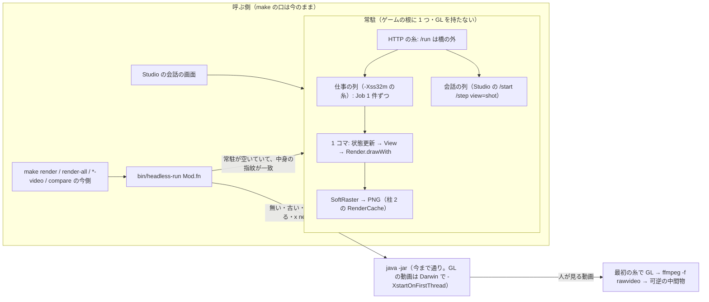

# 描き出しと比べを速くする（renderdesign・0.50 の想定）

状態: **設計のみ・未実装**（2026-10-19）。実装は依頼主がこのメモを見てから。辛口のレビューを 1 回通した版（結論は 8 節）。

柱は 3 本ある。このメモが扱うのは柱 1 と柱 3 の 2 本。

- 柱 1: 窓なしのゲームを常駐させる
- 柱 2: 描く命令のハッシュで比べる。別の担当が作っている（engine のブランチ `ababup1192/drawhash`）
- 柱 3: 人が見る絵だけ GPU で塗る

柱 2 については、口を読み合わせるだけにする。読んだのは `engine_tools/src/DrawHash.flix` と `RenderCache.flix`（2026-10-19 時点で未コミット）。
比べの基準の写しの取り置き（`spike/compare-cache` の `go/internal/compare/basecache.go`）は、柱 2 と同じ段で入れる。

## 0. どこに時間が消えているか（実測）

| 場面 | 状態更新・場面を組む | 描く命令 | 塗る | PNG | JVM・jar・JIT |
|---|---|---|---|---|---|
| 動画 transition 910 コマ（Mac mini） | 7.1 ms/コマ | 7.8 ms/コマ | 塗る + PNG で約 215 ms/コマ（93%） | 塗るに含む | 1 回だけ |
| reference-check 194 枚（ウォーム・この Mac） | 約 3 s | 1.8 s | 203 s（うちシェーダー面が約 70%） | 8.5 s | 約 2 s（src が変わった回は jar の作り直しで +65〜72 s） |
| 会話の 1 枚撮り（novel-starter） | | | | | コールド 9〜12 s・ウォーム 0.5 s 前後 |
| internet_dungeon の 1 枚撮り（`HEADLESS_PORT`） | | | 0.8〜1.0 s | | コールド 6.8〜7.2 s、常駐の 2 枚目以降 3.35〜3.66 s |

常駐の 3.35 s の内訳は、約 1 s が Doc の読み直し、約 1 s が `shotOf` の中の `kitOf`（フォントとアトラスを作る）。

ここから言えること:

- **静止画の束（reference-check）は、時間のほぼ全部が塗り。** 効くのは柱 2 で、同じなら塗らないと 223.7 s が 12.4 s になった（実測）。
  柱 1 で消えるのは JVM の分（全体の 2〜3%）だけ。
- **1 枚撮りと短い render は、JVM・温まり・kit が大半。** 効くのは柱 1。ただし kit と Doc を撮る間で取っておかないと、3.4 s から先は縮まない。
- **動画は、時間のほぼ全部が塗り。** ゲームが常に動くので 910 コマが 910 種の絵になり、柱 2 の「同じなら塗らない」は 1 本の中では効かない。効くのは柱 3。
  一方、基準と今の比べには柱 2 が効く。基準と今は同じ動きの列なので、変えていないコマは鍵がそろう。

## 1. 全体の形



決めたこと:

- **make の口とゲームの Makefile は変えない。** 常駐を使うかどうかは `bin/headless-run` の中で決める。
  使えなければ今の `java -jar` に戻る。checkd と同じく、少しでも怪しければ素の道へ回す。
- **SoftRaster を正本のままにする。** 比べ（compare・reference-check・柱 2 の鍵）は SoftRaster の絵だけで決める。
  GPU の絵を使うのは、人が見る mp4 だけ。**GPU の mp4 は柱 2 の鍵の約束の外**にある（3.5 節）。
- **遊ぶ時の道（窓ありの実機）には何も足さない。** drawhash の鍵も常駐も、描き出しと比べの道（headless・compare・reference-check）でしか動かない。遊ぶ時の道に触るのは段 4a の切り出しだけで、その重さは段 4a の完了条件で測って確かめる。
- **純粋な関数に IO を足さない。** 状態更新・View・drawWith・`DrawHash` の鍵の組み立ては今のまま残す。
  常駐・取り置き・GPU は全部、入口のすぐ下の IO の層に置く（iopure が寄せた形）。

## 2. 柱 1: 窓なしのゲームを常駐させる

### 2.1 口

engine_world の `App.Headless` に足す。`App.App` の型には欄を足さない。
欄を足すと、字面で組んでいるゲームが全部直しになる（0.49 の `shot = None` と同じ手当てを繰り返さない）。

```flix
// engine_world/src/App/Headless.flix
/// 常駐が受ける要求 1 件。外から作らせない（常駐だけが作る）。
enum RequestData({ env = Map[String, String], out = java.io.PrintStream, err = java.io.PrintStream })
pub type alias Request = RequestData

/// 要求の env（呼ぶ側のプロセスの環境変数を丸ごと）。
pub def envOf(req: Request): Map[String, String]
/// 要求の標準出力・標準エラー（子プロセスの出力をここへ向ける時に使う）。
pub def outOf(req: Request): java.io.PrintStream
pub def errOf(req: Request): java.io.PrintStream

/// 常駐が受ける入口 1 つ。name は bin/headless-run に渡す名前（"SceneRender.one"）。
pub type alias Job = { name = String, kind = JobKind, run = Request -> Int32 \ IO }
/// 静止画（常駐で流す）か、動画（GPU で塗るなら常駐に送らない）か。
pub enum JobKind with Eq { case Still, case Video }
/// 名前は "<モジュール>.<関数>" に組む。
pub def job(module: String, fn: String, run: Request -> Int32 \ IO): Job
pub def videoJob(module: String, fn: String, run: Request -> Int32 \ IO): Job

/// 窓なしのゲーム（/start・/step・view=shot）+ 入口の束（/run）で待ち受ける。
pub def serveJobs(app: App.App[w, ef], jobs: List[Job]): Unit \ ef + Fs.FileRead + IO
/// App を持たないゲーム。/start・/step・view=shot には「未対応」と答える。
pub def serveJobsOnly(jobs: List[Job]): Unit \ IO
// 今の serve(app) は serveJobs(app, Nil) と同じ動きのまま残す。
```

- **入口の束はゲームが組む**（生成しない）。要求をまたいで取っておく物（2.2 節）は、ゲームがここで 1 回だけ作り、閉包で入口へ渡す。
  こうすると Java の static に隠さずに済み、型も保てる。名前の字は束を組む所に直に書かず、各モジュールの `jobs` が自分の名前で組む。

  ```flix
  // src/render/SceneRender.flix（ゲーム）
  pub def jobs(shared: RenderKit.Shared): List[App.Headless.Job] =
      App.Headless.job("SceneRender", "one", req -> oneJob(shared, req)) ::
      App.Headless.job("SceneRender", "all", req -> allJob(shared, req)) :: Nil

  // src/E2e.flix（ゲーム）
  pub def serveHeadless(): Unit \ IO =
      let shared = RenderKit.freshShared();   // 取っておく物の置き場（2.2 節）
      let jobs = SceneRender.jobs(shared) ::: FlowVideo.jobs(shared);
      run { App.Headless.serveJobs(Game.app(Controls.loadDocs()), jobs) } with Fs.FileRead.runWithIO
  ```

- **名前と中身のずれを止める。** `job("SceneRender", "one", …)` の中身が `allJob` を呼んでいても型は通る。そこで 3 つで止める:
  (1) lint: `job("M", "f", req -> fJob(` の形以外を止める（`f` と `fJob` の字が合っていること）。
  (2) 常駐は起動時に、`jobs` の名前が全部 dispatcher の入口（`pub def f(): Unit \ IO` の 1 行形）にあることを確かめ、無ければ立たない。
  (3) `fge resident verify --all` は束の全部の名前を 1 回ずつ素の道と比べる（リリース前）。

- 入口の形は `pub def <名前>Job(…, req: App.Headless.Request): Int32 \ IO`。戻り値は終了コード。
  中身は iopure の `mainWith(env)` の形と同じで、`envOf(req)` だけを読む。素の道の入口（`pub def one(): Unit \ IO`）は
  `RenderEnv.exitWith(oneJob(RenderKit.freshShared(), App.Headless.requestFromProcess()))` の 1 行にする。
  `requestFromProcess` は今のプロセスの env と標準出力で作る。こうすれば、常駐と素の道が同じ中身を通る。
- **束に無い入口は常駐の対象外**で、今まで通り毎回 `java -jar` で流す。**一度に全部は替えない。**
- `bin/headless-run` の dispatcher は今のまま残す。常駐を起こす時だけ、ゲームの `E2e.serveHeadless` を流す。
  名前の一覧は、起動した常駐に `GET /hello` で聞く（生成コードが署名のずれで jar を作れなくなる穴を作らない）。

HTTP の口（今の `/help /starts /state /start /step /quit` に足す）:

| 口 | 中身 | 答え |
|---|---|---|
| `GET /hello` | 常駐の名乗り | `pid`・`dir`・`manifest`（2.3 節の中身の指紋）・`jobs`（束の名前）・`busy`（仕事の列で走っている要求の名前か空）・`served`（流した数） |
| `POST /run?entry=SceneRender.one` | 本文は呼ぶ側の環境変数（`KEY=VALUE` の行） | 1 行ずつの流れ。`o <字>`（標準出力）・`e <字>`（標準エラー）・最後に `x <終了コード>` か `x oom` か `x stale` か `x needs-gl` |

- **動画の入口は束の中で先に名乗る。** `Job` に `kind = JobKind`（`Still` / `Video`）を持たせ、`App.Headless.videoJob(…)` で組む。
  クライアントは `/hello` の `jobs` で kind を見て、`Video` で `FGE_GPU` が `off` でなければ、常駐に送らず最初から素の道で流す（3.3 節）。
  `x needs-gl` はその守りの漏れを拾う最後の砦で、`Still` と名乗った入口が GL を開こうとした時に返る。flow を流しきってから open する入口では
  それまでの出力が出ているので、クライアントは区切りの 1 行を出してから素の道で流し直し、lint の漏れとして知らせる。

- `/run` は今の橋（答えを 10 秒待って 503。`RemoteDebug.flix:118-122`）に**乗せない**。`/render` の `serveRender` と同じく
  橋の外の handler にして、終わるまで流し続ける（910 コマの動画は数十秒かかる）。
- 出力の行には頭に 1 字を付ける。入口が `x 0` の字を出しても、終わりの印と取り違えない。
- 入口の `println` の行き先: 常駐は起動時に 1 回だけ、`System.out` / `System.err` を「糸ごとに行き先を引く PrintStream」に差し替える。
  会話の列と仕事の列が並んで走るので、要求ごとに `System.setOut` すると互いの出力が混ざる。行き先は要求の糸に置き
  （`InheritableThreadLocal`）、要求の糸から生まれた糸も同じ行き先へ書く。行き先の無い糸（共有のプール・起動時に作った糸）の出力は
  常駐の記録 `build/headless/resident.log` へ行き、要求の流れには混ざらない。入口が起こす子プロセス（ffmpeg）の出力は `outOf(req)` / `errOf(req)` へ写す。
- クライアントは Go に置く（`go/internal/resident`・`bin/fge resident run|status|stop|verify`）。`bin/headless-run` は jar の判定と作り直しを
  今のまま行ったあと、まず `fge resident run` を試す。終了コード 125（常駐を使えない）のときだけ、今の `java -jar` へ進む。
  見た目と終了コードは素の道と同じにする（checkd と同じ約束）。
- `x oom`（`OutOfMemoryError`）のとき、常駐は自分で終わる。クライアントは `[resident] メモリが足りず常駐が落ちた — 素の道で流し直す` の
  区切りを 1 行出してから、素の道で流し直す。途中まで出た出力が 2 度出ることは、この区切りで分かるようにする。
  偽の赤は出さない（checkd の OOM と同じ扱い）。`bug!` などで入口が止まったときは、素の道と同じ終了コード（1）に合わせる。

### 2.2 撮る間で取っておく物（kit・Doc）

常駐の 1 枚が 3.4 s で止まるのは、kit と Doc に約 2 s かかるから。これを消す。

**取っておく物と、要求ごとに作る物を、型で分ける。** 今の kit には、要求をまたいではいけない物が混ざっている。
テクスチャのキャッシュ（`SoftRaster.freshTextureCache`、名前で引く）と、1 回だけ知らせる印（`freshTexWarnLog`）がそれ
（`VideoKit.flix:114`・`SceneRender.flix:340`）。kit ごと取っておくと、PNG を描き直した次の要求でも古い絵で塗り（偽の緑）、
2 回目の要求からは知らせが消える。

| 取っておく（`RenderKit.Shared`） | 要求ごとに作る（`RenderKit.PerRequest`） |
|---|---|
| フォントのアトラス・ドット絵のアトラス・Doc を読んだ値（`Controls.loadDocs()` の結果） | `SoftRaster.TextureCache`・`TexWarnLog`・`RenderCache.Session`・World |

`Shared` 型には `PerRequest` の欄を持たせない。アトラスの `BufferedImage` は、lanes の糸が読むだけで書かない。
この約束は WhyNot に残す。

engine_tools に置く取り置きの口:

```flix
pub mod ContentCache {
    enum CacheData[a](...)                 // 外から作らせない
    pub type alias Cache[a] = CacheData[a]
    pub def fresh(): Cache[a] \ IO
    /// params ごとに、前回 build がファイルから受け取った物と今のディスクが同じなら前の値を返し、違えば build で作り直す。
    /// build の中の Fs.FileRead は記録するハンドラで受け、外の Fs.FileRead へ投げ直しながら記録する（手で列挙させない）。
    /// Java から直に読む物（TTF・ImageIO）は extraFiles で明示する。
    pub def loadOrBuild(cache: Cache[a], params: String, extraFiles: List[String],
                        build: Unit -> a \ ef + Fs.FileRead): a \ ef + Fs.FileRead + IO
}
```

- **記録するのは Fs.FileRead の全部の操作**: 読んだ中身（ハンドラが受け取ったバイト列そのものから SHA を取る。後から読み直さないので、
  作っている最中の保存を取りこぼさない）・`exists` の答え（無かった物は `missing`）・一覧の並び（sprite が増えた・Doc が足されたが見える）。
  次の要求では、記録した操作を同じ順にもう一度だけ行い、答えが全部同じなら前の値を使う。
- **params ごとに 4 つまで持つ**（Day と Night を交互に撮るたびに作り直さない）。古い順に捨てる。
- `ContentCache` は会話の列と仕事の列の両方から引かれるので、中の表は糸をまたいで安全な形にする（同じ params を同時に作るときは片方が待つ）。

- **鍵は中身の SHA-256 だけにし、更新時刻は見ない。** checkd は macOS の見回りが遅れたせいで、書き換え前のソースを検査して緑を返した
  （`docs/checkd.md`）。同じ穴を作らない。Doc とフォントは小さいので、毎回ハッシュしても数 ms で済む。
- **鍵にするファイルの列は、手で書かせない。** `Controls.loadDocs()` が読むファイルや sprite.json を 1 つ書き漏らすと、古い値が返る。
  だから `Fs.FileRead` を記録するハンドラで取る。`Fs.FileRead` を通らず Java から読む物の書き漏らしは、2.5 節の verify で見つける
  （Doc を書き換えた後の 1 回を必ず含める）。
- 取り置きは、作るのに時間がかかり、入力のファイルが決まっている物だけにする。World は取っておかない。始まりを組むたびに作り直す（0.49 の約束のまま）。

### 2.3 古い jar のまま答える危険の止め方

checkd が偽の緑を返したのは、常駐が見ている物とディスクの物がずれたまま答えたから。ここでは、ずれうる所を 2 段に分けて両方を確かめる。

| 段 | 今 | 後 |
|---|---|---|
| src → jar | `find -newer jar`（更新時刻だけ。`headless-run:97-109`） | **毎回**、src の `.flix`・flix.toml・lib の中身の SHA と、java の旗（`HEADLESS_JAVA_OPTS`）・`JAVA` の字を並べた**中身の指紋** `build/headless/manifest.sha` を作り、jar を作った時の物と比べる。違えば作り直す（旗だけの違いは常駐の立て直しだけ）。更新時刻では省かない。src は小さく数十 ms、lib の fpkg を足しても 100 ms 前後の見込み（段 2 で測る） |
| jar → 常駐 | 見ていない | 常駐は起動時に manifest を読んで控え、`/hello` で返す。クライアントはディスクの manifest と一致した時だけ要求する。違えば `POST /quit` で落として立て直す。常駐も `/run` のたびに manifest のファイルを読み直し、違えば `x stale` と答えて自分で終わる |

- エンジンの fpkg は lib の中にあるので、中身の指紋に入る。`use-engine` でブランチの作業場へ向けたときも指紋が変わるので、ここで止まる。
- **jar が作れないとき**、今は黙って `flix run`（毎回全量コンパイル）に落ちる。これを大きく知らせる:
  `[headless] jar が作れない — flix run で流す（毎回 60 秒以上かかる）: <最初のエラー 1 行>`。
  常駐は古い jar のまま答えない（上の表の 2 段目が止める）。
- 入口を足すと jar が作れなくなる、という所も先に除く。`SceneRender.one` は JVM のメソッドの大きさの上限ぎりぎりにある。
  この仕事のついでに、場面の表を小さな関数へ分ける（5 節）。

### 2.4 heavy の鍵・メモリ・寿命・Studio

- **heavy の鍵は要求ごとに取る。** 常駐そのものは鍵を持たず、待っている間に枠を塞がない。make の口は今まで通り `bin/fge heavy` に包まれて走り、
  その中で常駐へ要求する。長い物と短い物の見分けも今のまま（Makefile の `HEAVY_LONG`）。
- **常駐はゲームの根に 1 つにして、Studio と共有する。** 今の Studio は会話のプレビューのために `E2e.serveHeadless` を自分で起こしている（`Headless.flix:7-11`）。
  それと別にもう 1 本立てると、同じ根に JVM が 2 本になる。そこで常駐の置き場を `build/headless/resident.json`（`pid`・`port`・`manifest`）の 1 か所にし、
  Studio・`bin/fge talk`・`bin/headless-run` は全部そこを読む。最初に要った人が起こす。
- **塞がっていたら待たない。** `/hello` の `busy` が空でなければ、すぐ素の道で流す。前に長い要求がいると、1 枚撮りが待った末に結局コールドで走ることになるので。
  素の道は heavy の枠の中で走るので、メモリの重なりは今と同じ上限に収まる。
- **Studio の会話は別の列。** `/start`・`/step`・`view=shot` は今と同じ主の列（World を作って答える列）で受け、`/run` の仕事の列とは分ける。
  Studio は素の道を持たないので、長い仕事の後ろで固めない。2 つの列が共有するのは `ContentCache` だけ。
- **止まった要求の見張り。** クライアントは、出力の行が `HEADLESS_SILENT_SECS`（既定 120 秒）来なければ常駐を kill し、
  `[resident] 返事が止まった — 常駐を落として素の道で流し直す` の区切りを出してから素の道で流す。
  入口は長い仕事でも 1 コマ・1 場面ごとに進みの行を出す（今も `[render]` の行がある）。
- **数の上限は checkd と同じ所から引く。** `bin/lint-rules/hooks.json` に `resident.maxDaemons` と 1 本のメモリ予算を足す。上限を超える根では常駐を立てず、素の道で流す。
  JVM には `-Xmx` で蓋をする（checkd で、蓋が無いと太り続けた経緯）。
- **寿命**: 誰も要求しなければ自分で終わる（`HEADLESS_IDLE_SECS`・既定 600 のまま）。要求 200 回かメモリの上限で、使い捨てて立て直す。
- **compare の基準側では常駐を使わない。** 基準は一時の worktree で描き、終わったら消す（`compare.go:170-178`）。二度と使わない JVM を残さないよう、`HEADLESS_RESIDENT=0` で流す。

### 2.5 常駐でも結果が同じであること（決定性）

常駐で崩れうるのは、要求をまたいで残る状態だけ。

| 残りうる物 | 止め方 |
|---|---|
| **env**: エンジンとゲームのあちこちが `System.getenv` を直に読む（`Flow.Cli.envOr` の FLOW・FLOW_VOCAB・FLOW_MODE・FLOW_RECORD、App の DEBUG・START、`SoftRaster` の FGE_SOFT_SERIAL、`RenderCache.rootDir` の FGE_RENDER_CACHE、`ReferenceDiff`、雛形の `SceneRender.envOr` の SHOT）。常駐では、要求の env ではなく、常駐を起こした時の env が見える | **env を読む所を、入口の頭の 1 か所に寄せる。** env は `App.Headless.envOf(req)` の表として入口の頭で 1 回だけ読み、要る値を設定の record（`VideoKit.Settings` の形）にして引数で奥へ渡す。iopure の `RenderEnv.snapshot` を入口の頭の行だけに許す決まり（`render-env-entry`）と同じ形を、engine にも入れる。engine の奥で直に読んでいる所（`Flow.Cli.envOr`・App の DEBUG/START・`SoftRaster` の FGE_SOFT_SERIAL・`RenderCache.rootDir`・`ReferenceDiff`）は、値を引数で受ける形に替える（`Flow.Cli.mainOf(app, env): Int32` など）。engine の `forbid.json` で、入口の頭の外の `System.getenv` と `Sys.Env.` を止める。**糸に env を置く仕組みは持たない。** 共有のプール（`SoftRaster.flix:394-398` の `parallel()`）や使い回す糸では、前の要求の値が残るので。奥の値は全部引数なので、`ContentCache` の `build` が env を黙って読む道も無い（`build` に要る値は params に入れる）。さらに常駐は、起動するときに env を決まったキーだけにして立てる（下の表）。書き漏らした `System.getenv` が残っても、常駐では「無い」と読むだけで、起動した人の値は見えない。それで答えが変われば verify の 1 と 2 が違いを出す |

常駐を起動するときに通す env（これ以外は渡さない）: `HOME`・`PATH`・`JAVA_HOME`・`TMPDIR`・`LANG`・`LC_*`（`sun.jnu.encoding` と日本語のパスのため）・
`JAVA_TOOL_OPTIONS`・`HEADLESS_*`（常駐そのものの設定）。`/hello` はこれらの値を返し、クライアントは自分の値と比べる。違えば常駐を落として立て直す。

| 残りうる物（続き） | 止め方 |
|---|---|
| `System.exit` を入口の奥で呼ぶと、常駐ごと落ちる | 入口は `Int32` を返す。`System.exit` を呼んでよいのは、入口の頭の行と `RenderEnv` だけにする。ゲームの `forbid.local.json` の `render-env` を engine の `forbid.json` へ持ってくる。エンジン自身の `Flow.Cli.main`（`Cli.flix:26,66`）と `Headless.shootOnce`（`Headless.flix:50,54`）もこの形に直す |
| `ConcurrentHashMap`・Ref の作り置き・Java の static | 要求ごとに作る（2.2 節の `PerRequest`）。要求をまたぐのは `ContentCache` だけ |
| 1 回だけ知らせる印 | `PerRequest` に入れる |
| 作業ディレクトリ・`System.setProperty`・既定のロケール | 常駐は自分の根で起動する。要求の `dir` が違えば 125 を返す |
| スタックの深さ | 要求は `-Xss32m` と同じ寸法を指定した糸（`new Thread(group, r, name, 32MB)`）で流す。常駐には `-XstartOnFirstThread` を付けない（GL を持たないので要らない。3.3 節） |

**機械で確かめる口**: `bin/fge resident verify <Mod.fn>…`。ゲームの根を一時の場所へ写し（`build/` と `debug/` を除く）、その写しの上で次の 5 つを流す。
作業中のツリーの Doc と PNG は書き換えない。書いたファイル（PNG・sfx.txt・drawhash.txt・frames.json）のバイトと、
終了コードと標準出力を比べ、違えば exit 1。終わったら写しを消す。

1. 素の道で 1 回
2. 常駐で 1 回
3. 別の入口を挟んで、常駐でもう 1 回（要求の順番による汚れを踏む）
4. Doc を 1 つと PNG を 1 つ書き換えてから、常駐で 1 回
5. 4 と同じ書き換えのまま、素の道で 1 回（4 と比べる）

agent-eval のお題 1 本と、リリース前の 1 回に入れる。毎回は回さない。

## 3. 柱 3: 人が見る絵だけ GPU で塗る

### 3.1 誰の絵を GPU で塗るか

| 描き出し | 塗る物 | 理由 |
|---|---|---|
| 動画の mp4（`*-video`・flow の動画） | **GPU**。使えなければ SoftRaster | 人が見る物で、塗りが 93% を占める |
| 動画の比べ（compare の動画の行） | 柱 2 の鍵の列で比べる。違うコマだけ SoftRaster で塗って並べる（3.5 節） | GPU と SoftRaster は、文字と多角形の縁が近似の関係（`docs/backend-parity.md`） |
| 静止画（render・render-all・reference-check） | SoftRaster のまま | 基準とバイトで比べるので。速くするのは柱 2 の取り置き |
| 1 枚撮り（`view=shot`・talk shot） | SoftRaster のまま | 塗りは 1 s 前後で、柱 1 の方が効く |

**GPU の道は、View から実機と同じ形で組み直す。** 理由は 3 つ。

- 文字の `Render.Item.Text` は、View がフォントのアトラスを持って組む（`Render.flix:28`）。SoftRaster の道は HeadlessFont のアトラス（`VideoKit.flix:75-85`）を、
  GL の道は SDF のアトラス（`LwjglLayer.flix:1234-1260`）を使う。
- SoftRaster 用の `DrawHash.Frame`（`SoftRaster.RasterReq`）は engine_tools の型で、render_gl からは見えない（render_gl は engine にしか依存しない）。
- Pass は、SoftRaster では先に描いた画素（`extraImages`）として渡し、GL では自分で描く。

そこで GL の道では、kit のアトラスを GL の物に差し替え、`World → View → Render.drawWith(GL のテクスチャ情報)` を組み直してから塗る。
これで実機と同じ道になり、人が見る動画は今より実機に近くなる。そのかわり、**鍵（柱 2）と GL の塗りは同じ値から出ない。**
GL の mp4 は鍵の約束の外に置き、比べには使わない（3.5 節）。

### 3.2 口

render_gl に足す（GL は render_gl の外へ出さない）。

**段 4a**: 塗りのコアを `withLwjgl` から切り出す。今の塗りは、`withLwjgl` の大きな閉包と、20 前後の `Static` な Ref の中にある
（テクスチャの登録簿・StaticLayer の bake・シェーダーのキャッシュ。`LwjglLayer.flix:340・400-520・768`）。
これを「状態のレコード + 1 コマ塗る関数」に分ける。実機の道もこの関数を呼ぶ形にする。画素は gl_parity が前後で変わらないことを確かめる。
**これはエンジンの大きな拡張なので、相談して見積もってから始める。**

```flix
// render_gl/src/GlOffscreen.flix（段 4a の上に乗る）
pub mod GlOffscreen {
    enum SessionData(...)                    // 外から作らせない。GL のコンテキストと、塗りのコアの状態を持つ
    pub type alias Session = SessionData
    /// 隠し窓（FLIX_GE_HIDDEN と同じ作り）と、design × scale の FBO を作る。画面が無い・GL が作れないなら Err(理由)。
    /// glfwInit の失敗も bug! ではなく Err で返す。macOS では Dock にアイコンを出さない（COCOA_MENUBAR のヒント）。
    pub def open(cfg: { design = Vec2, scale = Int32, background = Color }): Result[String, Session] \ IO
    /// 実機の Game 効果と同じテクスチャ情報・フォントのアトラス（View と drawWith に渡す）。
    pub def textureInfoOf(session: Session): String -> Option[GameEngine.TextureInfo] \ IO
    pub def fontAtlasOf(session: Session, name: String, size: Float64): FontAtlas \ IO
    /// Doc から作ったメモリ上の画像（ドット絵のアトラス `PxSpriteAtlas.asImages` など）を名前で載せる。
    /// ファイルの無いテクスチャはこれで載せる。載っていない名前を塗ろうとしたら `[video] GL に無いテクスチャ: <名前>` を 1 回言う。
    pub def uploadImage(session: Session, name: String, image: java.awt.image.BufferedImage): Unit \ IO
    /// 1 コマを FBO に塗り、RGBA の生の画素を buf に読み戻す。上下は直さず、ffmpeg の vflip に任せる。
    pub def paintInto(session: Session, frame: { drawables = List[GameEngine.Drawable],
                      polygons = List[GameEngine.PolygonRenderCmd], surfaces = List[GameEngine.ShaderSurface] },
                      buf: java.nio.ByteBuffer): Unit \ IO
    pub def close(session: Session): Unit \ IO
}
```

- **Session は 1 要求に 1 本。** テクスチャの登録簿は名前で引くので、要求をまたいで使い回すと、描き直した PNG でも古い絵で塗る。
  窓と FBO を作る費用（数百 ms の見込み）は、動画 1 本に 1 回なら払ってよい。

**段 4b**: 動画の書き出しを、塗る物を選ぶ 1 つの口にまとめる。ゲームの `VideoKit.writeFramesWhere`・`writeFramesBaked`・`SceneRender.burnItems` に
同じ並びが重なっているので、それをここに寄せる。

```flix
pub mod VideoOut {
    pub enum Painter with Eq, ToString { case Gl, case Soft }
    enum SinkData[w](...)
    pub type alias Sink[w] = SinkData[w]
    /// 文字のアトラスの出どころ。GL なら GlOffscreen.fontAtlasOf、Soft なら HeadlessFont（名前と大きさ → アトラス）。
    pub type alias FontAtlasSource = String -> Float64 -> FontAtlas
    /// 1 本の動画の設定。scene は「アトラス → World → items」（GL では GL のアトラス、Soft では HeadlessFont のアトラスを渡す）。
    pub type alias VideoConfig[w] = {
        outDir = String, fps = Int32, design = Vec2, scale = Int32, background = Color,
        scene = FontAtlasSource -> w -> List[Render.PlacedItem],
        images = Map[String, java.awt.image.BufferedImage],  // ファイルの無いテクスチャ（GL へは uploadImage で載せる）
        wanted = Int32 -> Bool,             // 描き直すコマ（今の writeFramesWhere の wanted）
        bakeShaders = Bool,                 // シェーダー面を 1 回だけ焼く（今の writeFramesBaked。Match3Video）
        audit = List[Render.PlacedItem] -> List[String]  // z の見回り・字の被り（今の VideoAudit.checkFrames）
    }
    /// FGE_GPU=auto|on|off。auto は GL を試し、駄目なら Soft にして 1 行知らせる。on で駄目なら Err。
    /// 常駐の中で GL を選ぶことになったら、何も書かずに NeedsGl を返す（入口はそのまま返し、常駐は x needs-gl と答える）。
    /// FGE_VIDEO_PAINT=all|none|frames:227-640 で塗るコマを決める（3.5 節）。ゲームの wanted とは両方が真のコマだけ塗る。
    pub def open(cfg: VideoConfig[w], req: App.Headless.Request): Result[OpenError, Sink[w]] \ IO
    pub enum OpenError { case NeedsGl, case Failed(String) }
    /// 1 コマ。いつも Soft の Frame から鍵（柱 2）を作って drawhash.txt に足す。塗りは Gl なら ffmpeg へ、Soft なら連番 PNG（RenderCache）へ。
    pub def write(sink: Sink[w], index: Int32, world: w): Unit \ IO
    /// 最後のコマの PNG（last.png）・sfx.txt・frames.json を書いて閉じる。
    pub def finish(sink: Sink[w], sounds: List[(Int32, String)]): VideoResult \ IO
}
```

- 鍵（drawhash.txt）を作るには、GL の道でも Soft の Frame の描く命令を組む（7〜9.5 ms/コマ）。GL の塗りと並べても安い。
  鍵を作らない形は用意しない。比べに使う列が抜けるので。
- **置き場**: engine_tools（SoftRaster・DrawHash）と render_gl の両方に依存する。今その形のパッケージは engine_full だけなので、どこに置くかは依頼主に決めてもらう（7 節）。
- **engine は `video.json` に書かない。** `video.json` はゲームの `bin/video-status.py` が出力名ごとに書いている物なので、書く人を 2 人にしない。
  engine はフォルダの中に `frames.json`（`painter`（`gl`・`soft`・`none`）・`frames`・`painted`（塗ったコマの範囲）・`fps`・`keys`（鍵のあるコマ数）・
  `audio`（sfx.txt・bgm.txt と、そこから鳴らす wav の中身の SHA-256 を畳んだ 1 本）・`last`）を書く。`none` は鍵だけを流して塗らなかった印（3.5 節）。
  `go/internal/videos/videos.go:172,193`（最後の画面とコマ数）と `bin/video-status.py:58`（`f*.png` を数える）は、frames.json があればそれを読むように替える。
  GL の道では連番の PNG が出ないので。

### 3.3 GL は 1 本の糸で

- **GL の動画は常駐で流さない。** 常駐は GL を持たず、`VideoOut.open` が GL を選ぶ要求には `x needs-gl` と答える。
  クライアントはその入口を素の道（`java -jar`）で流し直す。このとき Darwin では `-XstartOnFirstThread` を付ける（`bin/flix:21-27` と同じ分け方）。
  動画 1 本は GL でも数十秒かかるので、JVM の立ち上げ（数秒）は 1 割以下。その代わりに、常駐から 3 つの危険を外せる。
  1 つ目は最初の糸の取り合い（会話の列・仕事の列・GL）。2 つ目は `-XstartOnFirstThread` の下で AWT が固まる危険（`bin/flix:29-31`）が
  会話の 1 枚撮りにまで及ぶこと。3 つ目は GL の Static な状態が要求をまたぐこと。
- 素の道の GL の動画では、最初の糸（OS の main）を GL 専用にする。入口は `-Xss32m` と同じ寸法を指定した糸で流す。最初の糸の 8 MB の
  スタックで深い再帰が溢れる穴を作らない。
- `java.awt.headless=true` は今も付けている（`headless-run:192`）。実機も GLFW と AWT headless を同じ JVM で使っている（`LwjglLayer.flix:341-344`）。
  確かめるのは、`-XstartOnFirstThread` の下で worker の糸が AWT（HeadlessFont → BufferedImage）を起こしても固まらないこと。
  試作の最初の 1 本で確かめる。固まった時は、2.4 節の見張り（出力が止まったら kill）と同じ物を素の道の GL の動画にも掛け、
  `FGE_GPU=off` で流し直す。
- 1 本の動画は 3 段に分ける。状態更新・View・drawWith・鍵（要求の糸）→ 塗りと読み戻し（最初の糸）→ ffmpeg の標準入力へ書く（別の糸）。
  段の間には長さの決まった列（4 コマ分）を置く。今の SoftRaster の 4 本の糸（`lanes()`）は Soft のときだけ使う。
- 読み戻しは、最初は `glReadPixels` を同期で行う。960×600 の RGBA は 1 コマ 2.3 MB。足りなければ PBO 2 枚で、読み戻しと次の塗りを重ねる（測ってから決める）。
- ffmpeg への渡し方: `-f rawvideo -pix_fmt rgba -s 960x600 -r <fps> -i - -vf vflip`。**中間物は可逆にする**（ffv1 の `frames.mkv`）。
  `bin/mix-video-sfx.py` は今と同じく `--slow`・`--crf` と音を掛けて mp4 を 1 回だけ圧縮する。2 回圧縮して絵を落とさない。
  fps は入口が知っている（flow のヘッダ・VideoKit の設定・TUT_FPS などの env）ので frames.json に書く。mix は frames.json があれば
  その fps を正にし、Makefile が渡す値は使わない（食い違いで止めない）。frames.json が `painter=none` なら、mix は何もせずに 0 で終わる。

### 3.4 画面の無い機械

- `FGE_GPU=auto`（既定）: `GlOffscreen.open` が `Err` なら Soft に戻り、`[video] GPU が使えない: <理由> — SoftRaster で塗る` を 1 行出す。
  frames.json の `painter` に残し、`bin/fge videos status` と Studio が表示する。
- 戻ったときの速さは今と同じで、遅くはならない。コマ数・sfx.txt・drawhash.txt は Gl と Soft で同じになる（塗る物しか変えないので）。
- CI（Linux・画面なし）では Soft で塗る。オフスクリーン GL を CI に用意しない判断（gl_parity と同じ）は変えない。

### 3.5 GPU の絵と鍵なしのコマを比べに混ぜない

- compare の動画の行は、両側の `drawhash.txt` と frames.json の `audio` を比べる。**全部のコマに鍵があり、鍵が全部一致し、`audio` も一致したときだけ「同じ」と言う。**
  そのときは mp4 を解かない。今の compare は音を mp4 の音声の md5 で比べている（`compare.go`）ので、絵の鍵だけで同じと言うと音の差が黙って消える。
  `audio` が違えば、今と同じく sfx.txt を名前つきで比べて知らせる（`音 -hit@12 +hit@13`）。
- 動画の比べは、make の口を今のまま 2 回呼んで進める（Makefile は変えない）。塗る量は env の `FGE_VIDEO_PAINT` で `VideoOut` に渡す。
  1. 基準・今の両側を `FGE_VIDEO_PAINT=none` で流す。鍵・sfx.txt・frames.json（`painter=none`）だけを書き、mix は何もせずに 0 で終わる。
     入口ごとに `hashOnly` の口を作らなくてよい（17 本の `*-video` が全部 `VideoOut` を通るので）。
  2. 違うコマがあれば、同じ heavy の鍵を持ったまま、両側を `FGE_VIDEO_PAINT=<フォルダ>:<範囲>,…` で流し直す（1 つの入口が bfx_* のように
     いくつものフォルダを書くので、フォルダごとに範囲を持つ）。並べる絵は SoftRaster で塗る（`FGE_GPU=off`）。
     状態更新はコマの頭から流し直す（コマを飛ばして World を作る口は持たない）。塗らないコマは 1 コマ 15 ms 前後なので、910 コマでも 15 s 前後。
- **鍵だけの流しを、人が見る動画の記録と取り違えない。** 今側の 1 は作業中のツリーの `debug/video/<名前>` を書き直すので、連番は消え、古い mp4 だけが残る。
  `bin/video-status.py`（とエンジンの `videos status`）は frames.json の `painter=none` を見て、記録を `ok` ではなく `keys-only` にする。
  `make status` と Studio は `keys-only` を「撮れていない（compare の鍵だけ）」と数え、古い mp4 を撮れた物として見せない。
- **mix の条件も「同じ」の中に入れる。** mix の引数（`--bgm`・`--sub`・`--drop`・`--slow`・`--crf`）と `mix-video-sfx.py` の中身の SHA を、mix が
  `<名前>.mix.json` に書く。compare は frames.json の `audio` と合わせてこれも比べる。違えば「mix が違う」と言い、今と同じく mp4 の音声の md5 で比べる。
- **basecache が当たったとき**は、写しの drawhash.txt と frames.json で 1 を済ませる。今側と全部一致すれば、基準の worktree は作らない。
  違いがあれば、そのときだけ基準の worktree を作って 2 を流す（写しには塗った絵が無いので）。
- **鍵が無いコマ（`None`）は「同じ」と数えない。** 両側をそのコマだけ Soft で塗り、画素で比べる（今の道）。エンジンのリポの雛形は lib に fpkg が無く、
  いつも `None` になる（`RenderCache.flix:205-215`）。その場合は全部のコマが今の道で比べられる。遅くなるだけで、偽の緑にはならない。
- 片側が古い形（drawhash.txt が無い）なら、今の mp4 のコマ比べに戻り、「基準が古い形」と知らせる。ただし片側が `painter=gl` のときは、
  mp4 では比べず（GL と Soft は画素が合わない）、両側を Soft で塗り直してから比べる。
- **基準の写し（basecache）の鍵**に、エンジンの fpkg の SHA と painter を足す。今の鍵の `engine` は local.mk の名前だけで中身を見ていないので、
  `use-engine` で作業場へ向けると古い写しを使ってしまう。写しには drawhash.txt と frames.json も入れる。
- reference-check と `RenderCache` は、SoftRaster の `BufferedImage` からしか書かない。GL の画素が SHA256SUMS や取り置きに入る道は、型の上で無い。

## 4. 柱 2 との口合わせ（drawhash のブランチを読んで）

- 1 コマの鍵は `DrawHash.computeKey(inputs, encoding, frame): Option[Key]` で、`Frame = { req, surfaces, extraFonts }`。`VideoOut.write` は Soft の Frame を 1 回組み、
  鍵と Soft の塗りの両方に同じ値を渡す（`RenderCache.writePng` の WhyNot と同じ約束）。GL の塗りは 3.1 節のとおり、別に組み直す。
- 鍵は**座標を丸めない**。drawhash の WhyNot のとおり、丸めた幅の中で画素が動いても同じ鍵になり、偽の緑になるから。
  依頼文にあった「格子に丸める案」は採らない。1 本の中で 910 種になる件は、柱 3 で塗りを安くして受け止める。
- 常駐の中では `RenderCache.freshSession()` を要求ごとに作る（2.2 節の `PerRequest`）。ファイルの指紋の取り置き（`digests`）を要求をまたいで持ちたければ、
  `ContentCache` を通す。柱 2 の側には、`RenderCache.rootDir` と `engineDigest` が env と作業ディレクトリを直に読んでいる所を、引数で受ける形にしてもらう
  （2.5 節の env の行）。
- 静止画の `SoftRaster.render*` は、もう `RenderCache.writePlainPng` を通る。柱 1 の常駐は、それに乗るだけでよい。

## 5. ゲームが書き換える所（internet_dungeon）

iopure（`ababup1192/id-x-iopure`）の形の上に積む。

| 今 | 後 | 何が薄くなるか |
|---|---|---|
| `SceneRender.one()` / `all()` と、非 pub の `oneWith(env)` | `oneJob(shared, req)` / `allJob(shared, req)`（pub・`Int32`）。`one()` / `all()` は `exitWith(oneJob(freshShared(), requestFromProcess()))` の 1 行 | 常駐の入口になる |
| `FlowVideo.play()` → `playWith(settings)`（もう `Int32` を返し、`RenderEnv.video` を通らない） | `playJob(shared, req)` | 常駐の入口になる |
| ほかの `*-video` の入口（`RenderEnv.video` の handler が `System.exit(1)` を呼ぶ） | handler が終了コードを返す形にする | 常駐ごと落ちない |
| `VideoKit.kitScaled` と `SceneRender.kitOf` で、フォントとアトラスを二重に組んでいる | `RenderKit.buildShared(atlasSource, look, camera, scale)` を 1 つにして `ContentCache.loadOrBuild` で包む。`PerRequest` は要求ごと | 撮るたびの kit（約 1 s）と Doc（約 1 s）が消える |
| `VideoKit.writeFramesWhere` / `writeFramesBaked` / `writeFrame`（drawWith → `renderToImageCached` → `Filmstrip.renderFrame`）と、`SceneRender.burnItems` の同じ並び | 動画はエンジンの `VideoOut`、静止画は `RenderCache.writePlainPng` | 塗る物の選択・鍵・連番がエンジンへ移る。ゲームに残るのは「World → 層 → items」と「コマの入力」と「見回りの中身」 |
| `bin/mix-video-sfx.py` が `f%04d.png` を読む | frames.json を見て、`frames.mkv`（Gl）か連番（Soft）を読む | PNG を通さない |
| `bin/video-status.py` が `f*.png` を数える | frames.json があれば、その `frames` と `last` を使う | |
| `SceneRender.one` がメソッドの大きさの上限ぎりぎり | 場面の表を `shotNames` ごとの小さな関数へ分ける | jar が作れなくなる穴を先に除く |

残る `unsafe`（`VideoKit.layersNoted`）は、エンジンの `ViewCtx#warnOnce` が知らせを値で返す口を持てば消せる。これはこのメモの範囲外（別の相談）。

ほかの雛形にも効くか:

| 雛形 | 柱 1 | 柱 3 |
|---|---|---|
| novel-starter | `E2e.serveHeadless` を `serveJobs(app, jobs)` に替え、`SceneRender.one/all` を `*Job` にする。Studio の会話の画面がそのまま速くなる | 動画の口は無い。flow の動画を足すなら `VideoOut` を使う |
| tetris-starter | `SceneRender.one` が `System.exit` と `envOr` を直に使っているので、`oneJob` にする。`E2e.play` の `Flow.Cli.main` は、エンジンの `Flow.Cli.mainOf(app, env): Int32` に替える | 同上 |
| rpg・game・platformer・race | `one/all` を `*Job` にする。App を持たない入口は `serveJobsOnly` を使う | 同上 |

雛形は `/add-template` の手順で直す。入口の形を変えるだけで絵は変わらないので、`reference/SHA256SUMS.txt` が前と同じことを確かめる。

## 6. 入れる順と完了条件

数は全部 **同じ機械（Mac mini）で 5 回流した中央値**で見る。ほかの重い仕事が走っていないこと（heavy の `--status` が空）を確かめてから測る。

| 段 | 入れる物 | 完了条件 |
|---|---|---|
| 0 | 今の数を測る | transition 動画・reference-check 194 枚・1 枚撮り（novel・internet_dungeon）の今の数と、その内訳（JVM・組む・命令・塗る・PNG・mix）を `docs/performance.md` に残す |
| 1 | 柱 2（別の担当）+ basecache（鍵に fpkg の SHA と painter） | 194 枚が全部同じときの reference-check が、今の **10% 以下**（実測は 12.4 / 223.7 = 5.5%）。同じ入力 2 回で、鍵が全部一致する |
| 2 | 柱 1a: `Request`・`Job`・`serveJobs`・`/run`・`fge resident`・中身の指紋・env の照合・jar が作れない時の大きな知らせ・Studio との共有 | `make render SHOT=title` の 2 回目が、コールドの **60% 以下**。`fge resident verify` の 5 つが `SceneRender.all` と `FlowVideo`（transition）で差 0。src を 1 行変えた次の要求が新しい jar で答える（agent-eval のお題）。SHOT・FLOW を変えた続けての要求が、どれも常駐で正しく答える。engine とゲームの src で、入口の頭の外の `System.getenv` / `Sys.Env.` が 0 件（lint） |
| 3 | 柱 1b: `ContentCache`・`RenderKit.Shared / PerRequest` | 常駐の 1 枚撮りで、**塗りを除いた時間が 0.4 s 以下**（今は約 2.5 s）。Doc を保存した直後の 1 枚に、その保存が効いている（10 回中 10 回）。PNG を描き直した直後の 1 枚に、新しい絵が出る（10 回中 10 回） |
| 4a | render_gl の塗りのコアを切り出す（相談してから） | `make gl-parity` が前後で差 0。**実機の道（窓ありで遊ぶ時）の 1 コマの時間を、変更の前と後で同じ場面・同じ機械で測り、悪くなっていない（差が測り誤差の内）。** あわせて R3 の予算の中（`docs/performance.md`） |
| 4b | 柱 3: `GlOffscreen`・`VideoOut`・frames.json・mix の受け口 | transition 910 コマの「入口の始まりからフレームの書き終わりまで」が、今の **25% 以下**（今は約 210 s → 50 s 前後）。mix は別に測る。`FGE_GPU=off` と画面の無い所（ssh の中）で、コマ数・sfx.txt・drawhash.txt が同じ。frames.json に painter が入る |
| 5 | compare の動画の行を drawhash.txt と `audio` で比べ、違うコマだけ塗る | deckFightLabel を変えたときに違うと言うコマが **227〜640 だけ**（試作の実測と同じ）。効果音の wav を 1 つだけ変えたとき「音が違う」と言う。変えていない動画の compare が mp4 を解かずに終わる。鍵なしの雛形で、今と同じ結果になる |
| 6 | 雛形の追随・早見表・agent-eval のお題 | 雛形 6 本の reference が前と同じ。`make agent-eval ONLY=<お題>` が当たる |

各段で `agents-pack/AGENTS.core.md` の早見表に 1 行、`agents-pack/agent-eval/engine.json` にお題を 1 本足す（AGENTS.md の決まり）。
段 2 と段 3 は柱 2 を待たずに始められる。段 4b と段 5 は柱 2 の後に入れる。

## 7. 依頼主の決定（2026-10-19）

7 つとも決まった（1〜6 はこのメモの勧めどおり）。

1. **`VideoOut` は engine_full に置く。**
2. **段 4a はやる。ただし段 2・3 の後。** 完了条件は 2 つ。`make gl-parity` が差 0 であること。実機の道（窓ありで遊ぶ時）の 1 コマの時間が、前後で悪くなっていないこと。
3. **入口の形 `<名前>Job(shared, req): Int32` を決まりにする。** 雛形 6 本とゲームの入口を順に替える。替えない入口は常駐しない（遅いだけ）。
4. **常駐は最初は手で入れる（`HEADLESS_RESIDENT=1` で使う）。** `verify` が 2 週間差 0 なら既定にする。
5. **env は入口の頭だけで読む決まりを engine に入れ、lint で止める。** 対象はエンジンの `Flow.Cli`・App の DEBUG/START・SoftRaster・RenderCache・雛形の SHOT、それとゲームの `RenderEnv`。
6. **GL の動画は常駐に入れない。** GL の動画は毎回 JVM を立てる（1 割以下）。
7. **jar が作れないとき、reference-check は既定で止まる。** 2.3 節では「大きく知らせて flix run で流す」としていたが、reference-check については止める方を既定にした。入れるのは drawhash の側。

## 8. レビューの結論（2026-10-19・1 回目 58 点 → 2 回目 72 点 → 3 回目 79 点 → この版）

### 3 回目（79 点）で直した所

| 指摘 | 直した所 |
|---|---|
| `System.setOut` は JVM に 1 本なので、会話の列と仕事の列の出力が混ざる | 起動時に 1 回だけ「糸ごとに行き先を引く PrintStream」に差し替える。行き先の無い糸は常駐の記録へ（2.1 節） |
| 糸に env を置く形は、共有のプール・使い回す糸・取り置きの build で前の要求の値が漏れる | 糸に env を置くのをやめた。env は入口の頭で 1 回読んで引数で渡す（iopure の形を engine にも）。build に要る値は params に入れる（2.5 節） |
| 鍵だけの流し（`painter=none`）が、人が見る動画の記録を `ok` にして古い mp4 を撮れた物に見せる | video-status が `keys-only` と記録し、`make status` と Studio は撮れていないと数える（3.5 節） |
| 空の env で起動すると locale と常駐の設定が消える | 通すキーを決めて書き、`/hello` で返してクライアントが照合する（2.5 節） |
| `audio` が mix の条件を見ていない | mix が引数とスクリプトの SHA を `<名前>.mix.json` に書き、compare が比べる（3.5 節） |
| 塗る範囲が 1 つしか渡せない（1 つの入口が複数のフォルダを書く） | `FGE_VIDEO_PAINT=<フォルダ>:<範囲>,…`（3.5 節） |
| `x needs-gl` の時点で出力が出ていることがある | `Job` の `kind` で動画を先に名乗り、クライアントが最初から素の道で流す。`x needs-gl` は漏れを拾う最後の砦（2.1 節） |

### 2 回目（72 点）で直した所

### 2 回目（72 点）で直した所

| 指摘 | 直した所 |
|---|---|
| env の照合のキーの表が手書き。SHOT・FLOW は要求ごとに変わるので常駐がほぼ使われない | env は入口の頭で要求の表から 1 回だけ読み、奥へは引数で渡す（3 回目で糸に置く形をやめた）。常駐は決まったキーだけの env で起動する。lint で入口の頭の外の `System.getenv` を止める（2.5 節） |
| 基準側の 2 回流しが make の口に乗らない（鍵だけだと mix が落ちる・入口ごとに hashOnly が要る・basecache が当たると worktree が無い） | `FGE_VIDEO_PAINT=none|frames:…` を env で渡し、mix は `painter=none` で 0 で終わる。basecache が当たっても違いがあれば worktree を作る（3.5 節） |
| 絵の鍵だけで「同じ」と言うと音の差が消える | frames.json の `audio`（sfx.txt・bgm.txt・wav の中身）も一致した時だけ同じ。完了条件の段 5 に音だけ変えた確かめを足した |
| 入口の束を手で書くと名前と中身がずれる | 各モジュールの `jobs` が組む。lint で `job("M","f", … fJob(` の形を確かめ、起動時に dispatcher と照合する（2.1 節） |
| ContentCache が read の中身しか記録しない・後から読み直す・値を 1 つしか持たない | 全部の操作（exists・一覧）を記録し、受け取ったバイト列から SHA を取る。params ごとに 4 つまで持つ（2.2 節） |
| Studio が長い要求の後ろで固まる・止まった要求を止められない | 会話の列と仕事の列を分けた。出力が 120 秒止まれば kill して素の道へ（2.4 節） |
| `-XstartOnFirstThread` の下の AWT が常駐全体を固めうる | GL の動画は常駐で流さず、`x needs-gl` で素の道へ回す（3.3 節） |
| Doc から作ったメモリ上のアトラスを GL へ渡す口が無い | `GlOffscreen.uploadImage` と `VideoConfig.images` を足した |
| 中身の指紋の入口が更新時刻のまま | 毎回中身をハッシュする。java の旗と JAVA も指紋に入れた（2.3 節） |
| 型の書き違い・fps の食い違いで止める規則・verify が作業中のツリーを書き換える | `Sink[w]`・`FontAtlasSource`・`OpenError` を直した。fps は frames.json を正にした。verify は一時の写しの上で流す |

### 1 回目（58 点）で直した所

辛口のレビュー役 1 人に、決定性・偽の緑・GPU の無い機械・ほかの雛形・既存の部品との融合・名前・完了条件・仕様漏れの 8 つの観点で読んでもらった。
直した所は次のとおり。

| 指摘 | 直した所 |
|---|---|
| 取っておく kit の中に、テクスチャのキャッシュと 1 回だけ知らせる印が混ざる（偽の緑・知らせが消える） | `RenderKit.Shared / PerRequest` を型で分けた（2.2 節） |
| 取っておく値を入口へ渡す道が無い・1 つの Memo に型の違う値を入れる形は Flix で書けない | 入口の束をゲームが手で書き、閉包で渡す形にした。`ContentCache[a]` を値の種類ごとに持つ（2.1・2.2 節） |
| 鍵にするファイルの列を手で書かせると、書き漏らしが偽の緑になる | `Fs.FileRead` を記録するハンドラで集める。Java から直に読む物だけ明示。漏れは verify の 4・5 で踏む |
| GL に Soft の `DrawHash.Frame` を渡す形は、パッケージの依存の向き・文字のアトラス・Pass のどれでも成り立たない | GL は View から実機と同じ形で組み直す。GL の mp4 は鍵の約束の外と明記（3.1 節） |
| GL の塗りを関数として呼べる口が今は無い | 段 4a として切り出しを独立させ、相談の項目に入れた（3.2・7 節） |
| エンジンとゲームが env を直に読むので、常駐では起動時の env が見える | 2.5 節の表の最初の行に入れた。替え終わるまでは、キーの値を照合して素の道へ回す |
| `-XstartOnFirstThread` と `-Xss32m` が両立しない・今の headless-run は旗を付けていない | 最初の糸は GL 専用、要求は寸法を指定した糸で流す。旗は Darwin だけ（3.3 節） |
| `/run` が 10 秒で 503 を返す橋に乗る・出力と終了コードの返し方が無い・OOM | 橋の外の handler にした。行の頭に 1 字の印を付け、`x <code>` で終わる。OOM は素の道で流し直す（2.1 節） |
| jar と src の照合が更新時刻のまま | 中身の指紋 manifest を常駐とクライアントの両方で照合する（2.3 節） |
| Studio の常駐と二重になる・塞がっていても 30 秒待つ・compare の基準の worktree に常駐が残る | 根に 1 つを Studio と共有する。塞がっていればすぐ素の道へ。基準側は常駐を使わない（2.4 節） |
| `VideoOut` が見回り・焼き・wanted を覆っていない。連番の PNG を読む人が壊れる。video.json を書く人が 2 人になる。mix で 2 回圧縮される | `VideoConfig` に入れた。engine は frames.json だけを書く。中間物は可逆の ffv1（3.2・3.3 節） |
| 鍵なしのコマ・基準の写しの鍵が偽の緑になりうる | 鍵なしは同じと数えず画素で比べる。basecache の鍵に fpkg の SHA と painter を足した（3.5 節） |
| 名前（`with*` の意味に外れる・`get` なのに重い） | `serveWith` → `serveJobs`、`*With(env)` → `*Job(shared, req)`、`getOrBuild` → `loadOrBuild` |
| §5 の事実の誤り（FlowVideo はもう Int32）・エンジン自身の `System.exit` | 直した。`Flow.Cli.main`・`Headless.shootOnce` も直す対象に入れた |
| 完了条件が揺れで落ちる・塗りの分と混ざる・段 4 が大きすぎる | 5 回の中央値の比にした。塗りを除いて測る。段 4 を 4a / 4b に分けた |

レビューで残った懸念（この版でも解けていない物）:

- 段 4a の大きさ。`withLwjgl` の切り出しは見積もりが要る。柱 3 の 4 倍速は、ここが前提になる。
- `ContentCache` の記録するハンドラで、`Fs.FileRead` を通らずに読まれる物がどれだけあるか。試作で数える。
- `-XstartOnFirstThread` の下で worker の糸が AWT を起こしたときに固まらないか。試作の最初の 1 本で確かめる。
