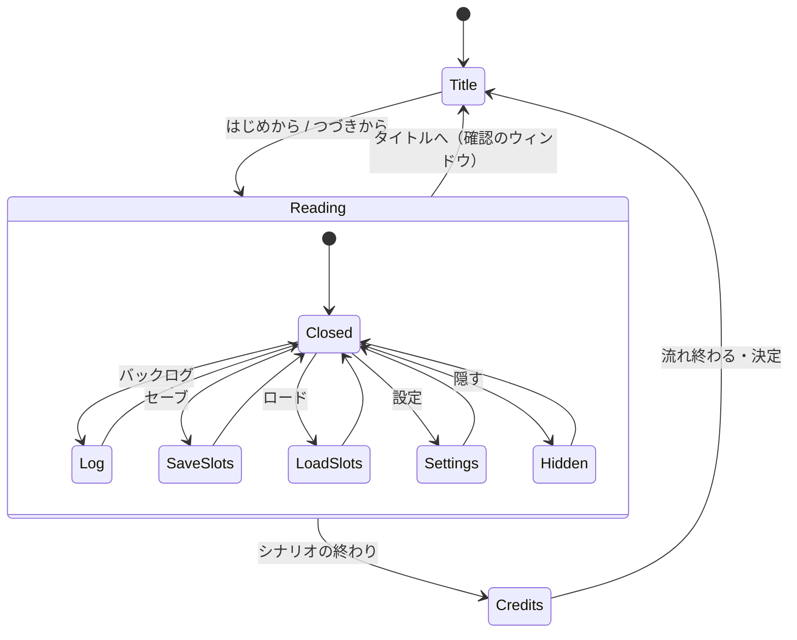

# 夏草の駅

flix_game_engine のサウンドノベルの手本。十年ぶりに祖母の町へ帰った「私」が、幼なじみの千夏と、
祖母が遺した真鍮の鍵の行き先をたどる。5 分ほどで読み終わり、選び方で結末が 3 つに分かれる。

背景は描かずに実写の写真（Wikimedia Commons の CC0 / CC BY。出典は [CREDITS.md](CREDITS.md)）を使い、
**ぼかしと時間帯の色はゲームの中でシェーダーが付ける**（同じ昼の写真が、夕暮れにも夜にも朝にもなる）。
文章は小説のように画面いっぱいに積む NVL と、下のウィンドウに 1 行ずつ出す ADV を、場面ごとに切り替える。
字は明朝（しっぽり明朝・OFL）。

## 始め方

Flix コンパイラはエンジンリポの `bin/flix` ラッパ経由で呼ぶので、devbox shell の外でも動きます。

| コマンド | 何をするか |
|---|---|
| `make run`    | ゲームを起動する（ウィンドウが開く） |
| `make debug`  | 保存即反映(watchFile)と F8 を有効にして起動 |
| `make check`  | 型検査だけ（一番速い確認） |
| `make test`   | テスト（規則・Doc の橋渡し・性質テスト） |
| `make render SHOT=nvl` | その場面だけ `debug/nvl.png` へ描き出す（場面は `title nvl adv choice lane engawa night morning log save load settings ask credits`） |
| `make render-all` | ギャラリー PNG を全部描き出す |
| `make flow FLOW=e2e/true_ending.flow` | タイトル画面から結末までを画面なしで流す（`e2e/bookmark.flow` はセーブとロード） |
| `bin/fge yarn build assets/talk` | シナリオを直した後に木（`assets/talk/dialogue.json`）を書き直す（エンジンの `bin/fge`） |
| `bin/fge snd build art/sfx.snd.star` | 環境音・効果音を作り直す（`atelier/sfx/` に書く。採用は `assets/sfx/` へ写す） |

## 遊び方

クリック / Enter / Space / Z で読み進める。文字が出ている途中で押すと全文が出る。
選択肢は ↑↓（またはマウス）で選んで決定。下の帯のボタンか、キーで:

| 操作 | キー |
|---|---|
| 戻る（1 つ前の台詞から読み直す。ロールバック） | PageUp / R |
| バックログ（ホイールを上へでも開く。台詞を押すとそこへ戻る） | L |
| オート（読み終えて少し待つと送る） | O |
| スキップ（既定は読んだ行だけ。選択肢の後に止めるかは設定） | K / Tab |
| クイックセーブ・クイックロード | F5 / F9 |
| ウィンドウを隠す（写真だけを見る） | H / Esc |
| セーブ・ロード・設定・タイトルへ | 下の帯のボタン |

- **セーブ・ロード**: 枠は 1 ページ 6 枠（2 列 × 3 行）。ページは「オート」「クイック」と番号の 3 ページ（Q / E で切り替え）。
  枠にはセーブした時の画面をそのまま縮めたサムネ・保存した日時・場所・話し手と台詞の頭が出る。上書き・削除（× か Delete）・
  読んでいる途中のロードは確認のウィンドウで尋ねる。オートセーブは場面（ノード）が変わるたびにオートのページの頭へ積む。
  ロードの画面は一番新しいセーブのページから開き、「続きから」は一番新しいセーブを読む。
- **設定**: 文字の速さ・オートの待ち・スキップする行（既読だけ / すべて）・選択肢の後のスキップ（止める / 続ける）・
  画面（ウィンドウ / 全画面）・全体と環境音と効果音の音量・ウィンドウの濃さ・初期設定に戻す。文字の速さの見本がその場で流れる。
- 閉じるボタンとタイトルへ戻るは確認のウィンドウを出す。ウィンドウを開いている間は物語の時計が止まる（文字送り・待ち・オートが進まない）。

キーの割り当ては `assets/novel.keys.json`。セーブ・既読・設定は `saves/novel.json` に残る（遊んだ人ごとの物なので git には入れない）。

## ノベルゲームの機能と、どこで読むか

| 機能 | 書く所 | 読む所 |
|---|---|---|
| 台詞・地の文・話し手 | `assets/talk/natsukusa.yarn`（Yarn Spinner の書き方） | `WorldRead.absorb` / `showLine` |
| ルビ（`[ruby=よみ]字[/ruby]`） | 同上 | `View.placeLine`（エンジンの `RichText.placeRuby`） |
| 選択肢・条件つきの選択肢・変数 | `-> …` `<<if>>` `<<set>>` `<<declare>>` | `WorldRead.pick` / `moveChoice` |
| 背景の写真を時間帯の色でぼかして切り替える | `<<bg 写真 時間帯 秒>>` + `assets/novel.backdrops.json` | `src/Backdrop.flix`（ShaderDoc の `TexBlur`） |
| NVL ⇄ ADV・頁をめくる | `<<nvl>>` `<<adv>>` `<<clear>>` | `Page.show` / `WorldRead.cue` |
| 環境音（ループ）・効果音 | `<<ambience 名>>` `<<se 名>>` + `art/sfx.snd.star` | `Controls.ambience` / `soundOf`・音量は `assets/novel.mixer.json` のバス |
| 画面の演出（蛍・揺れ） | `<<fx fireflies>>` `<<shake>>` | `View.particles` / `Stage.shakeOffset` |
| 待ち | `<<wait 秒>>` | エンジンの YarnRunner が待つ |
| 文字送り・オート・スキップ・既読 | 速さは `assets/novel.kind.json` と設定の画面 | `WorldRead.step` / `autoOrSkip` / `markSeen` |
| バックログ・そこへ戻る | 行数は `novel.kind.json` の `logMax` | `WorldLog.scrollLog` / `jumpTo`・`View.logPanel` |
| ロールバック | — | `WorldLog.rollback`（ログの各行に、その行を出した時のブックマークを持たせる） |
| セーブ・ロード・クイック・オート | ページと枠の数は `Saves.tabs` / `perPage` | `WorldSaves.writeSlot` / `loadFrom` / `quickSave`（YarnRunner のブックマーク）・`src/Saves.flix`・`View.slotsPanel` |
| 確認のウィンドウ | 文言は `novel.story.json` の labels | `World.askFor`・`WorldMenu.answer`・`View.askLayer` |
| 設定 | スライダーの範囲は `novel.kind.json` の `*Slider` | `WorldSettings.adjust` / `activate` / `withLevel` / `withSide`・`View.settingsPanel` |
| タイトル画面・クレジット | `assets/novel.story.json`・`assets/novel.credits.json` | `View.title` / `View.credits` |

## 読む順

**遊ぶ → シナリオを読む → コードを読む → JSON をいじる** の順で仕組みが見えます。

1. `make run` で一度読み終える。
2. `assets/talk/natsukusa.yarn` を読む。頭のコメントに、書けるコマンドの一覧がある。
3. コードは **入口 → 状態 → 描画 → 入力** の順:
   1. `src/Game.flix` … 部品を App に繋ぐ目次。冒頭に**毎フレームの流れ**。`src/Main.flix` は Doc とセーブを読んで起動するだけ。
      App の w は描く元と遊びの状態の組（エンジンの `Resources.With[Res.Res, World.World]`）。系・絵・問いは `Resources` の口で両方を受ける。
   2. `src/Res.flix` … 描く元: Doc とシナリオの木（`Controls.loadRes` が読む）。読むだけで、Doc の読み直しの時だけ替わる。
      規則と View は `res` を先頭の引数で受ける。
   3. `src/World.flix` … 遊びの状態の形（Doc は持たない）。下の図のとおり、今の場面（`Scene`）が持つ値はその場面の payload に入っていて、
      読んでいる間だけの値（シナリオの現在地 `talk`・頁・選択肢・ログ）は `Reading` の中にしか無い。
      開いている画面（`Panel`）と確認のウィンドウ（`ask`）も、そのカーソルを payload に持つ。
      規則は章ごとのファイルに分けてある: 読み進める `WorldRead`（まず `advance` と `pick`、次に `absorb` で
      実行器の出来事を舞台・頁・ログへ反映）・バックログと戻る `WorldLog`・セーブとロード `WorldSaves`・設定 `WorldSettings`・
      タイトルとボタンと確認のウィンドウ `WorldMenu`。遷移を起こす関数の doc に `[遷移: X→Y]`。
      時計は 2 本: 文字送り・待ち・背景の切り替えは物語の時計 `storyClock`（画面を開くと止まる = `paceOf`）、
      タイトル画面・クレジット・蛍の明滅・知らせは実時間 `realNow`。
      規則は音を鳴らさず、返事を出来事（`Emit`）として出す。Controls が集めて音へ替える。
   4. `src/Stage.flix` … 演出のコマンド（`<<bg>>` など）の意味と舞台の状態。`src/Page.flix` … NVL の頁と ADV の 1 行。
   5. `src/Backdrop.flix` … 写真をぼかして時間帯の色にするシェーダーの式（ShaderDoc を code で組む）。
   6. `src/View.flix` … 状態を絵に写す（背景と蛍は `frame`、文章・ウィンドウ・タイトル画面は `hud`）。
      部品は World を丸ごと受けず、描く元（`Env.res`）・セーブ・時刻だけの `Env` と、その場面の payload（`Read`・`TitleItem` など）を受ける。
   7. `src/Controls.flix` … 入力の効き先（確認のウィンドウ → 画面 → 選択肢 → ボタン → 本文）と音と Doc の読み直し（`docTable`。読み直すのは Res で、シナリオの行だけ `WorldRead.settleDialogue` が World を収め直す）。
4. `assets/*.json` の数値や色を変えて、`make debug` で保存即反映を見る（ぼかしの強さ・時間帯の色・文字の速さ・音量）。

### 状態の図

`Scene` は Title・Reading・Credits、`Panel` は Closed・Log・SaveSlots・LoadSlots・Settings・Hidden（タイトル画面からもロードと設定を開ける）。
確認のウィンドウ（`ask`）はどの画面の上にも重なり、開いている間は下の入力を受けない。

## 素材を差し替える

- **写真**: `assets/bg/` に 960×540 の JPG を置き、`project.json` の `textures` と `assets/novel.backdrops.json` の
  `photos` に名前を足す。出典とライセンスは `CREDITS.md` と `assets/novel.credits.json` の両方に書く（CC BY は
  作者名・ライセンス・元の場所を画面にも出す）。ぼかすので、写真の解像度は低くてよい。
- **時間帯の色**: `novel.backdrops.json` の `grades`。夜は `exposure` を落とし `tint` を青へ、夕暮れは `sky` を橙へ。
- **字**: `project.json` の `fonts`。使う字だけに縮めた subset を置いている（シナリオに無い字を足したら作り直す）。
